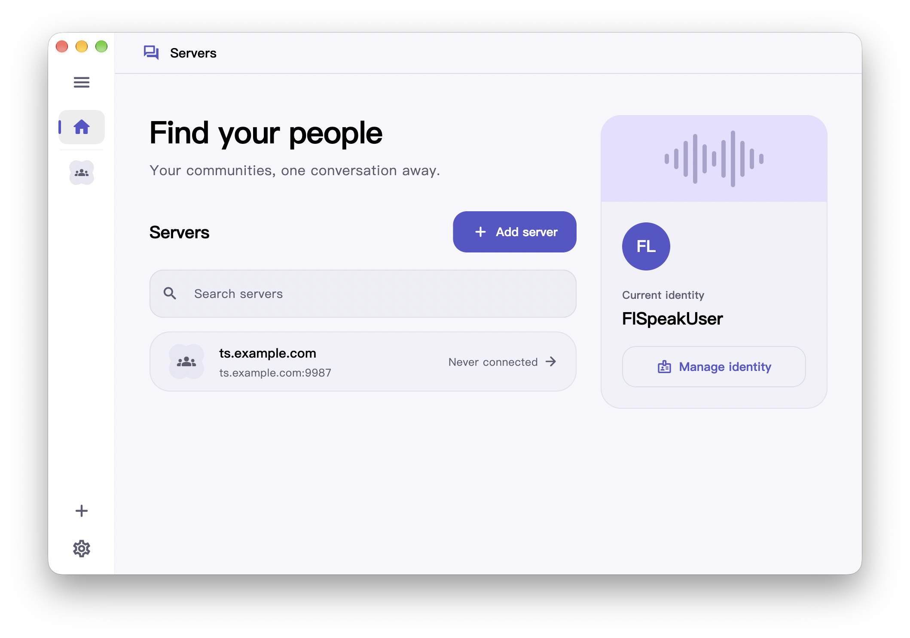

<div align="center">

# FlSpeak

[English](README.md) | [中文](README.zh.md)

<!-- prettier-ignore-start -->
<!-- markdownlint-disable-next-line MD036 -->
_Yet another teamspeak client, multi-platform and open-source._
<!-- prettier-ignore-end -->

  <a href="https://github.com/Dr1mH4X/FlSpeak/releases">
    
  </a>

  

  <a href="https://github.com/Dr1mH4X/FlSpeak/blob/main/LICENSE">
    
  </a>
  

<br><br>

<picture>
  <source media="(prefers-color-scheme: dark)" srcset="website/public/preview-dark.png">
  <source media="(prefers-color-scheme: light)" srcset="website/public/preview-light.png">
  
</picture>

<br><br>

Powered by [tsclient-rs](https://github.com/Dr1mH4X/tsclient-rs)

</div>

## Quick Start

### Download

Pre-built binaries for macOS, Windows, Linux, and Android are published on [GitHub Releases](https://github.com/Dr1mH4X/FlSpeak/releases). Download the archive or installer matching your operating system and run directly.

### Build and Run from Source

#### Prerequisites

- **Flutter**: `>= 3.29.0`
- **Rust**: `>= 1.85.0`
- **just**: command runner (`cargo install just` or `brew install just`)
- **Platform Dependencies**:
  - macOS: `pkg-config` (recommended: `brew install pkgconf`)
  - Linux: `libsecret-1-dev`, `libasound2-dev`

#### Steps

Clone the repository and install dependencies:

```sh
git clone https://github.com/Dr1mH4X/FlSpeak.git
cd FlSpeak
flutter pub get
```

Run the desktop client on your current platform:

```sh
just run
```

To run checks and tests across Dart and Rust codebases:

```sh
just check
```

## Documentation

- [Architecture Overview](docs/architecture.md): Deep-dive into threading model, actor runtime, and layers.
- [Development Guide](docs/development.md): Environment setup, commands, FFI codegen, and packaging.
- [Testing Guidelines](docs/testing.md): Automated tests, manual live probes, and CI requirements.
- [Connection Boundaries & Security](docs/connection-boundary.md): Self-hosted connection constraints and forbidden hosts.
- [Agent & Contributor Rules](AGENTS.md): Standing orders and workflow rules for developers and AI agents.

## License & Disclaimer

This project is licensed under the **AGPL-3.0-only** license. See [LICENSE](LICENSE) for details.

> FlSpeak is an unofficial third-party client and is not affiliated with, endorsed by, or associated with TeamSpeak Systems GmbH. "TeamSpeak" is a registered trademark of its respective owner.
