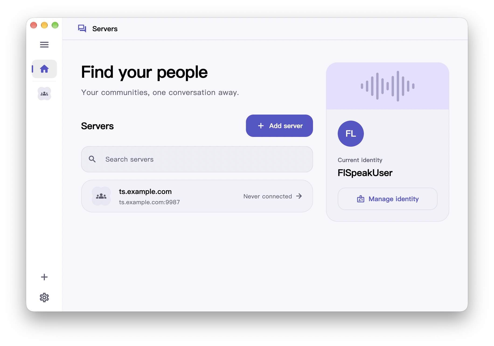

<div align="center">

# FlSpeak

[English](README.md) | [中文](README.zh.md)

<!-- prettier-ignore-start -->
<!-- markdownlint-disable-next-line MD036 -->
_又一个多平台，开放的 teamspeak 客户端._
<!-- prettier-ignore-end -->

  <a href="https://github.com/Dr1mH4X/FlSpeak/releases">
    
  </a>

  

  <a href="https://github.com/Dr1mH4X/FlSpeak/blob/main/LICENSE">
    
  </a>
  

<br><br>

<picture>
  <source media="(prefers-color-scheme: dark)" srcset="website/public/preview-dark.png">
  <source media="(prefers-color-scheme: light)" srcset="website/public/preview-light.png">
  
</picture>

<br><br>

由 [tsclient-rs](https://github.com/Dr1mH4X/tsclient-rs) 驱动

</div>

## 快速开始

### 下载

在 [GitHub Releases](https://github.com/Dr1mH4X/FlSpeak/releases) 页面提供了适用于 macOS、Windows、Linux 和 Android 的安装包。

### 从源码构建运行

#### 前置要求

- **Flutter**：`>= 3.29.0`
- **Rust**：`>= 1.85.0`
- **just**：命令执行器（可通过 `cargo install just` 或 `brew install just` 安装）
- **平台系统依赖**：
  - macOS：`pkg-config`（推荐使用 `brew install pkgconf`）
  - Linux：`libsecret-1-dev`、`libasound2-dev`

#### 步骤

克隆代码并同步依赖：

```sh
git clone https://github.com/Dr1mH4X/FlSpeak.git
cd FlSpeak
flutter pub get
```

启动当前宿主平台的桌面开发客户端：

```sh
just run
```

运行全套质量门禁与跨语言测试：

```sh
just check
```

## 文档指引

- [架构总览](docs/architecture.md)：线程模型、Actor 运行时、事件总线与系统分层。
- [开发指南](docs/development.md)：环境搭建、常用命令、FFI 代码生成与打包流水线。
- [测试约定](docs/testing.md)：自动化测试、单测规范、真实服务器探针与质量门禁。
- [连接边界与安全约束](docs/connection-boundary.md)：自托管连接规则与官方域名黑名单清单。
- [Agent 与贡献者守则](AGENTS.md)：全局规则、防御模式审查与行为工作流。

## 许可证与免责声明

本项目采用 **AGPL-3.0-only** 开源许可证，详情参阅 [LICENSE](LICENSE)。

> FlSpeak 是非官方社区客户端，与 TeamSpeak Systems GmbH 无隶属关系。"TeamSpeak" 与相关商标归其权利人所有。
